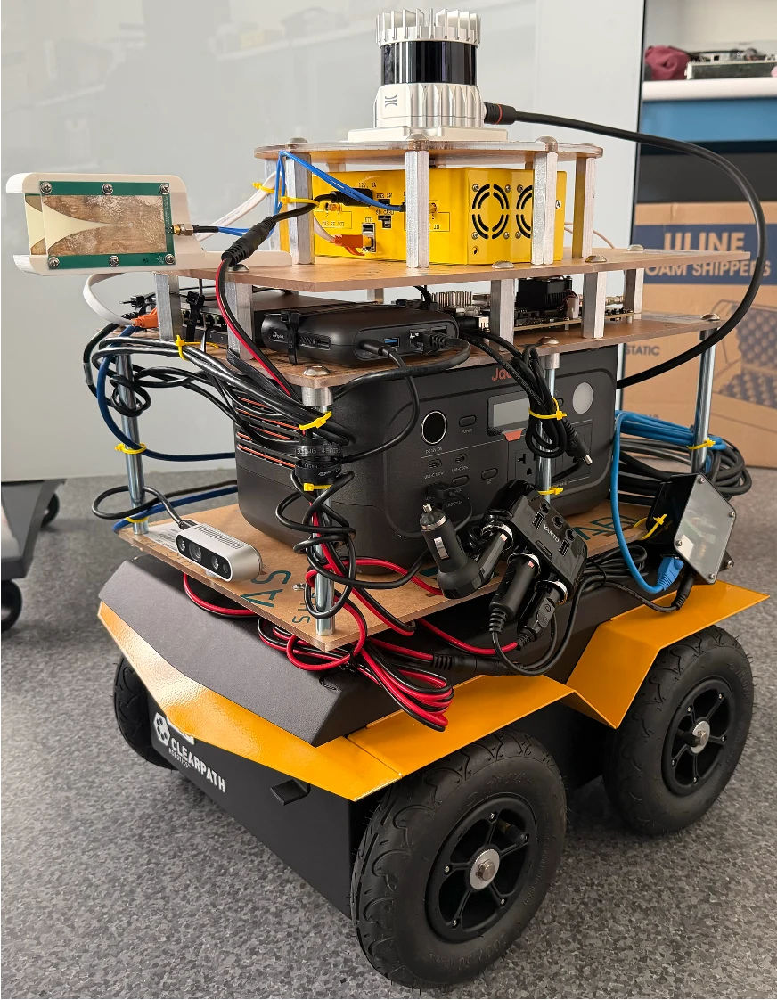
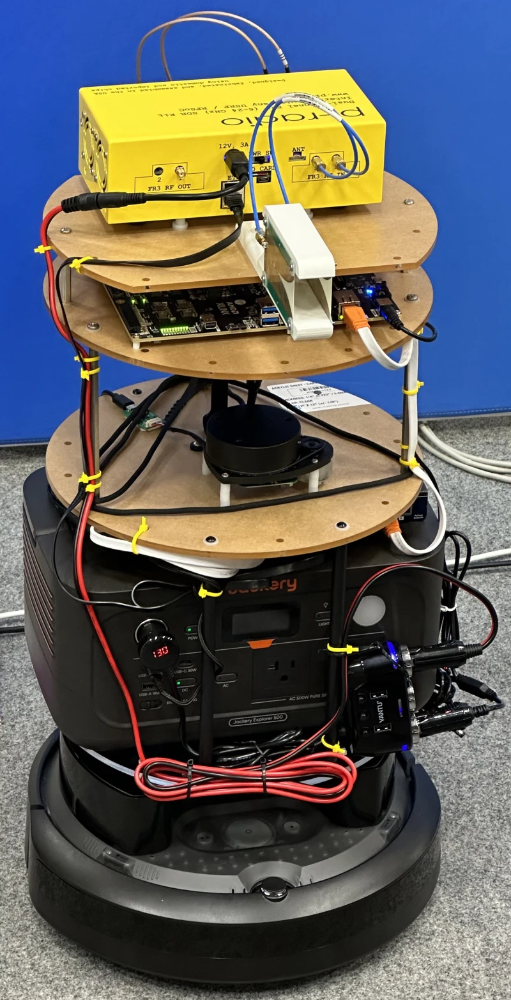
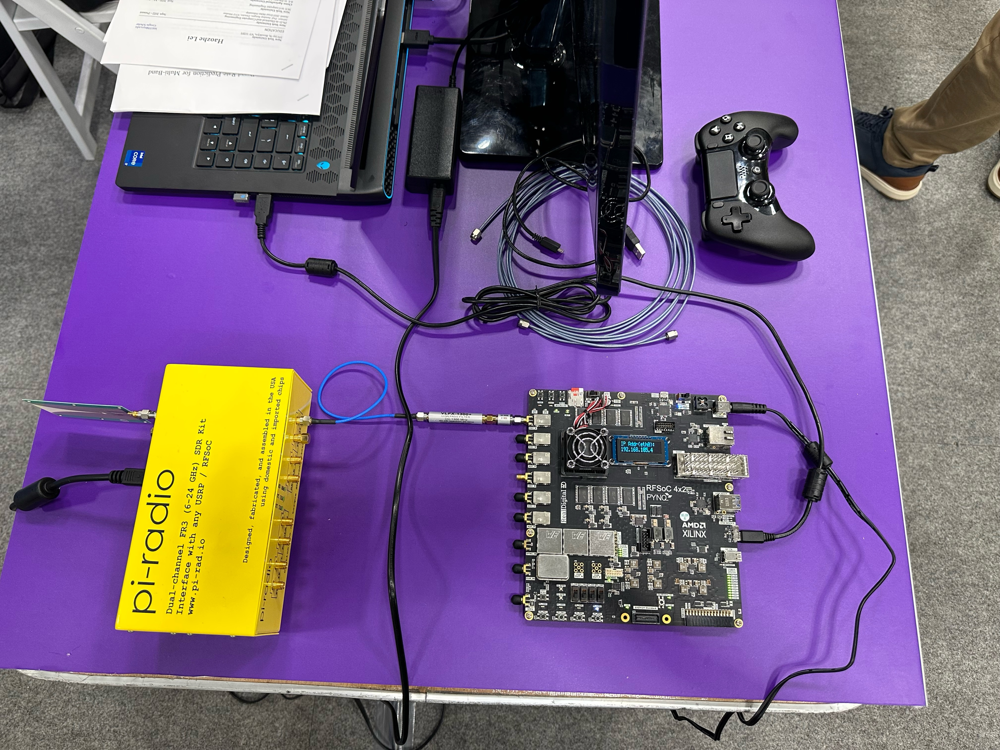

**MobiFR3** is a heterogeneous robotic RF testbed for studying wireless localization with geometric and visual context. Its **TurtleBot4 and Jackal UGV configurations** combine mobile sensing with a dedicated Pi-Radio FR3 radio payload on each robot. The platform connects 10-GHz channel-sounding experiments with ROS 2, robot pose and map information, LiDAR, and RGB-D sensing.

My contributions span system architecture, experiment design, RF–robot alignment, measurement-aligned simulation, probabilistic inference, and evaluation. I work with and mentor student collaborators on RF operation, calibration, and data collection.

  <figure class="project-figure-card">
    
    <figcaption><strong>Jackal UGV configuration · 2026.</strong> The mounted RF payload is complemented by Ouster OS1 3D LiDAR and an Intel RealSense RGB-D camera.</figcaption>
  </figure>
  <figure class="project-figure-card">
    
    <figcaption><strong>Earlier TurtleBot4 configuration.</strong> The compact platform combines the FR3 radio payload with 2D LiDAR and onboard RGB-D sensing; it was used in the earlier robotic RF experiments.</figcaption>
  </figure>

*The Pi-Radio SDR stack combines FR3 RF hardware, Vivaldi antennas, and local compute/control equipment.*

## From system to inference

The earlier MobiFR3 setup provides the measured data and controlled geometry used by [MAGNETAR](/projects/magnetar-joint-rf-pose-inference/). The algorithm infers a joint posterior over **RF transmitter position and heading**, conditioned on known receiver poses and asynchronous AoA/SNR multipath snapshots. Real-to-sim calibration incorporates measured antenna patterns and RF-chain/noise effects.

The broader research program also includes [MAPLE-RF](/projects/maple-rf-partial-map-localization/) for source localization with partial maps, [LOCUS-DT](/projects/locus-dt-digital-twin-localization/) for digital-twin-conditioned posterior inference, and [physics-informed wireless navigation](/projects/wireless-indoor-navigation/). These simulation studies motivate future closed-loop experiments on the testbed.

## Media & Public Demonstrations

### Brooklyn 6G Summit 2026

[Finding the Invisible — watch the 45-second research showcase](/#media), featuring MAGNETAR's robotic RF experiments on MobiFR3 and MAPLE-RF's partial-map localization simulations.

### Brooklyn 6G Summit 2025

  <iframe src="https://www.youtube-nocookie.com/embed/2_3FGVCxYKY" title="Brooklyn 6G Summit 2025 interview on FR3 robotic localization" loading="lazy" allow="accelerometer; autoplay; clipboard-write; encrypted-media; gyroscope; picture-in-picture; web-share" referrerpolicy="strict-origin-when-cross-origin" allowfullscreen></iframe>

*Interview recorded at the Brooklyn 6G Summit 2025.*

At the 2025 Brooklyn 6G Summit, I demonstrated the FR3 robotic sensing and localization system, combining TurtleBot4 mobility, Pi-Radio hardware, angle-of-arrival measurements, and SLAM-based mapping. The demonstration showed how RF observations can support indoor positioning when visual information is incomplete or unavailable.

  <a href="https://www.youtube.com/watch?v=2_3FGVCxYKY" target="_blank" rel="noopener">Watch the interview</a>
  <a href="https://www.5gtechnologyworld.com/brooklyn-6g-summit-2025-research-exhibits/" target="_blank" rel="noopener">5G Technology World feature</a>
  <a href="https://engineering.nyu.edu/news/brooklyn-6g-summit-2025-research-exhibits" target="_blank" rel="noopener">NYU Tandon coverage</a>

**System capabilities**
- Pi-Radio SDR channel sounding with Vivaldi antennas and motion-controlled 10-GHz measurements.
- Transmit/receive waveform control, capture, synchronization, channel estimation, SNR estimation, and AoA processing.
- TurtleBot4 and Jackal mobile configurations with platform-specific LiDAR and RGB-D sensing; recorded Jackal SLAM and geometric/visual examples complement the RF observations.
- Scripted TurtleBot4, linear-track, and D48 pan-tilt motion in the earlier reproducible RF measurement grids.
- Measurement-aligned Sionna RT scenes with TX/RX pose and motion, measured antenna patterns, and stochastic RF-chain/noise effects.
- Physical validation for posterior localization and future closed-loop sensing/navigation experiments.
